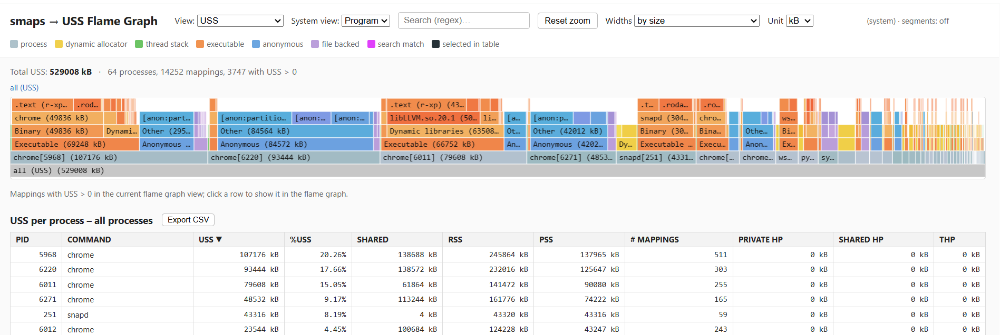
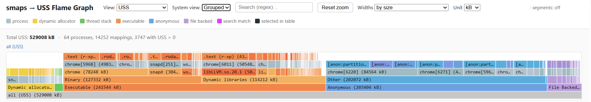
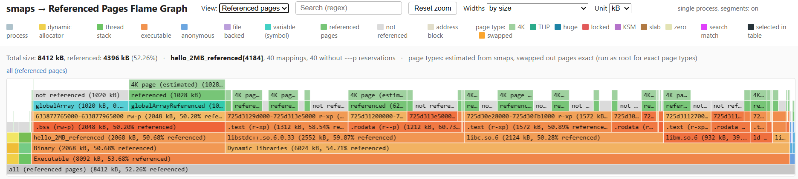

# flame.py: USS flame graphs from `/proc/<pid>/smaps`

`flame.py` is a single-file Python 3 tool that shows where the private memory (USS = `Private_Clean` + `Private_Dirty`) of a Linux process, or of the whole system, goes. It prints a text summary. With `-f` it also writes a self-contained interactive HTML flame graph with zoom, regex search, tooltips, and per-process / per-group tables that you can export to CSV.

Each mapping is put into one of these groups: **dynamic allocator** (heap, glibc malloc arenas), **thread stack**, **executable** (binary and shared libraries, split into `.text` / `.rodata` / `.data` / `.bss`), **anonymous**, or **file backed**.

## Screenshots

**Whole system, per program** (`flame.py -s -f`):



**Whole system, grouped by category** (the "Grouped" system view):



**Referenced pages** (`flame.py -p PID -f -g`): every mapping split into referenced and not referenced pages from `/proc/<pid>/pagemap`. Referenced pages are broken down by page type (4K, THP, hugetlbfs, locked, KSM, zero page, swapped out), and global variables are shown too:



## Requirements

- Linux with Python 3 (standard library only)
- Optional: `nm` and `readelf` (binutils) for `-g`, and `gdb` for `-m` / `-t`
- Run it as root to read other users' processes and get exact page types from `/proc/kpageflags`

## Usage

```
flame.py -p 1234           memory summary of one process
flame.py -p 1234 -f        flame graph (flame_<program>_1234_<time>.html)
flame.py -p 1234 -f -g     also show global variables (>4K) of the executable
flame.py -p 1234 -f -g all also show global variables of all shared libraries
flame.py -p 1234 -m        glibc mallinfo() statistics (via gdb)
flame.py -p 1234 -t        call malloc_trim(0) (via gdb) and show before/after
flame.py -s                memory summary of the whole system
flame.py -s -f             flame graph of the whole system
flame.py -i FILE           process a saved smaps file (or `tail -n +1 /proc/*/smaps`)
```

Run `flame.py -h` to see all options.

> **Note:** `-m` and `-t` attach `gdb`, which stops the process while it is attached. If the process is inside `malloc` at that moment, it can deadlock.

## License

[MIT](LICENSE)
